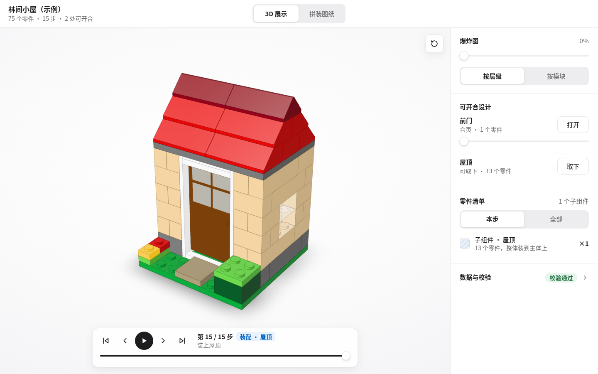
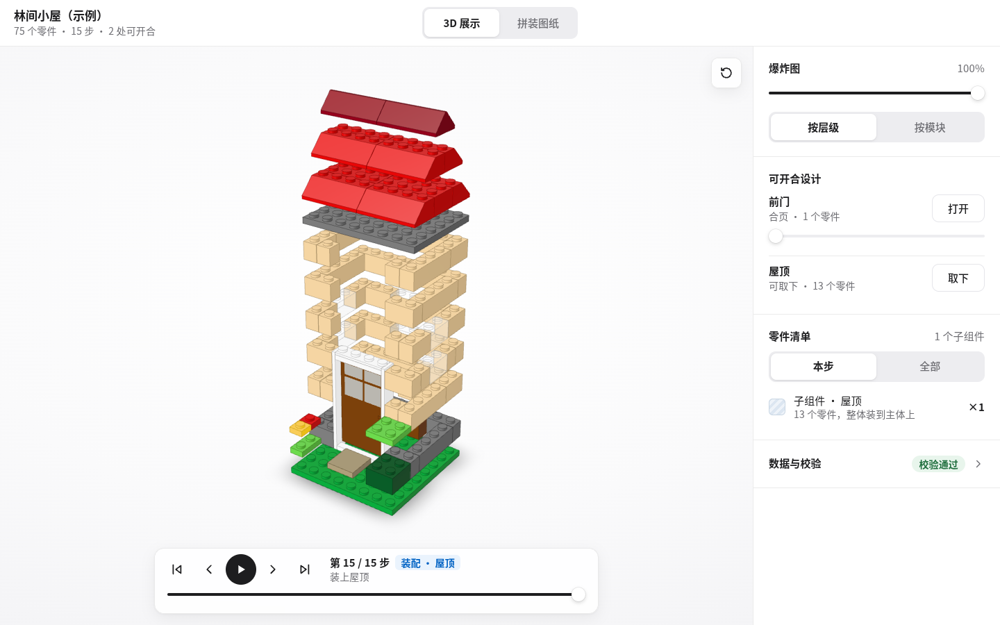
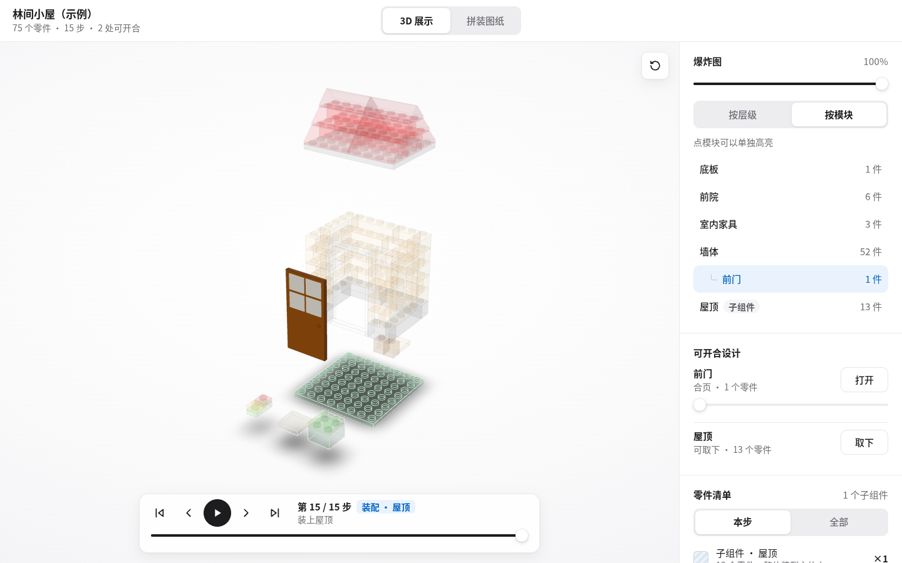
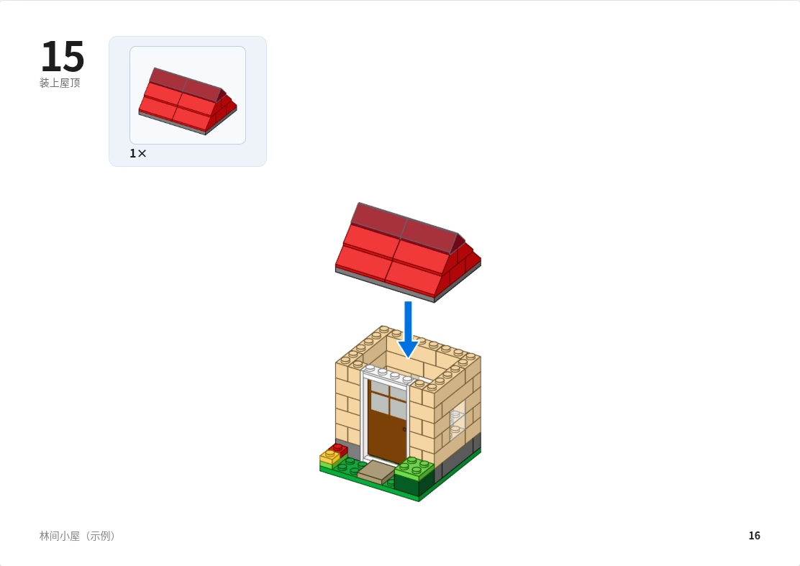
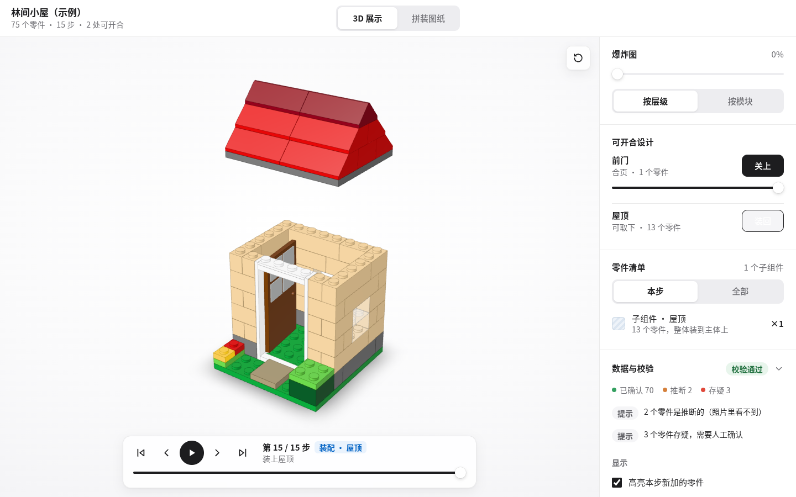
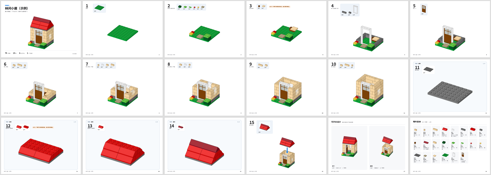

# BrickKit

**把自己拼的乐高实物模型（多角度照片）整理成可交互的 3D 拼装演示、爆炸图和乐高风格拼装图纸。**

> **在线演示**：
> - **示例 1 · 林间小屋**：[3D 交互展示](https://lawrence7y.github.io/brickkit/) ｜ [乐高风格拼装图纸（`#view=book`）](https://lawrence7y.github.io/brickkit/#view=book)
> - **示例 2 · 四翼重装侦察机甲塔（实物照片重建）**：[3D 交互展示](https://lawrence7y.github.io/brickkit/mecha.html) ｜ [乐高风格拼装图纸（`#view=book`）](https://lawrence7y.github.io/brickkit/mecha.html#view=book)

BrickKit 定义了一套数据格式（`brickbuild` 0.2）、照片拍摄规范、校验工具和单文件网页查看器，并提供输出 JSON 的命令行，方便 AI 智能体（Harness）接入：智能体负责“看照片 → 写数据”，BrickKit 负责“校验 → 渲染对比 → 展示 → 出图纸”。



| 爆炸图 · 按层级 | 爆炸图 · 按模块 |
|---|---|
|  |  |

| 拼装图纸 · 子组件装配页 | 可开合设计 |
|---|---|
|  |  |



---

## 功能

**3D 展示**（白色简洁风格）
- 逐步播放拼装过程（←/→ 切换，空格播放），新零件从上方落下；子组件单独在旁边拼好，装配步整体落到主体上。
- 爆炸图两种模式：**按层级**（按高度分层拉开）/ **按模块**（按 `modules[].explode` 整体移开，支持父子模块叠加）。
- 模块列表点击高亮；可开合设计（合页 / 滑动 / 可取下）用滑块开合。
- 零件清单、存疑零件标记、“数据与校验”面板；可拖入任意 `.brick.json` 打开。

**拼装图纸**（乐高说明书风格）
- 封面 → 每步一页（大步骤号、本步零件 callout “n×”）→ 子组件步骤放进“子组件”框 → 装配页（子组件缩略图 + 装配箭头）→ 可开合设计页 → 零件清单。
- 可选“淡化已拼好的部分”；A4 横版，浏览器直接打印 / 存为 PDF，或用命令行 `booklet` 生成。
- 示例输出：[`out/cottage.booklet.pdf`](out/cottage.booklet.pdf)（18 页）。

**数据与校验**
- 零件 / 颜色用 LDraw 编号；校验重叠、悬空、步骤顺序（每一步零件都要有支撑）、模块、子组件、可开合设计、证据照片。
- 导出 LDraw；有子组件时导出 MPD，可在 Studio / LeoCAD / LPub3D 打开。

---

## 快速开始

需要 Node.js 18+。

```bash
npm install                      # three、esbuild、playwright
node build.mjs                   # 打包 dist/viewer.html
open dist/viewer.html            # 直接双击也可以；内嵌示例模型“林间小屋”
```

`dist/viewer.html` 是完全自包含的单文件，可以直接发给别人或放到任何静态网站上。地址加 `#view=book` 直接打开拼装图纸。

命令行（需要 Chromium 的命令会自动查找系统 Chromium，或设置 `CHROMIUM_PATH`；也可以运行 `npx playwright install chromium`）：

```bash
node cli/brickkit.mjs validate examples/cottage.brick.json --photos examples/cottage.photos.json --pretty
node cli/brickkit.mjs booklet  examples/cottage.brick.json -o out/cottage.booklet.pdf
node cli/brickkit.mjs render   examples/cottage.brick.json -o out/explode.png --explode 100 --emode module
```

---

## 命令行

所有命令输出 JSON（加 `--pretty` 美化）；退出码 `0` 通过、`1` 有问题、`2` 参数错误。

| 命令 | 作用 |
|---|---|
| `validate <model> [--photos photos.json]` | 校验模型，输出 `errors / warnings / info / stats` |
| `check-photos <photos.json> [--model m] [--dir 照片目录]` | 检查照片是否齐全、分辨率是否达标 |
| `photo-plan [--model m]` | 生成需要用户拍的照片清单 |
| `plan <model>` | 步骤计划：每一步的零件数、子组件、装配步 |
| `catalog [关键词]` / `colors` | 查零件目录 / 颜色代码 |
| `catalog-fetch [--dir catalog/ldraw] [--mirror 整库解压目录] [--force] [--full]` | 下载/更新 LDraw 官方零件库素材（CC BY 2.0）。默认装目录引用的 167 种零件及闭包到 `catalog/ldraw/`；`--full` 从 `--mirror`（complete.zip 解压目录）整库安装约 3.7 万文件到 `catalog/ldraw-full/`（.gitignore，本地素材） |
| `catalog-verify [--dir catalog/ldraw]` | 用官方几何实测尺寸逐件核对 `catalog/parts.json`，产出 `catalog/ldraw/verification.json` |
| `bom <model> [--step n]` | 零件清单 |
| `export-ldraw <model> [-o out.ldr\|out.mpd]` | 导出 LDraw / MPD |
| `viewer <model> [-o out.html]` | 生成内嵌该模型的单文件查看器 |
| `render <model> -o out.png [--az --el --step --explode 0-100 --emode layer\|module --mech door:90,roof:1 --w --h --status]` | 渲染 3D 图，用来和用户照片对比 |
| `diff <model> --photos photos.json --dir 照片目录 [--out-dir out/diff] [--w 640] [--mode joint\|sweep\|fixed]` | 数值对账。默认 `joint` 联合标定：每张照片 320px 粗扫 `标注az±30°步15 × 4 向滚转` 取最优，全组取分数加权圆周中位数得共享 yaw 偏移 Δ，正式打分统一 `az=标注az+Δ` 并冻结滚转——压制逐照片择优虚高；`sweep` = 旧逐照片 `±20°` 方位角 + 滚转择优（沿用旧公式）；`fixed` = 仅清单姿态 + 4 向滚转（批量变体筛选）。总分 = `0.35 归一IoU + 0.15 长宽比 + 0.20 颜色直方图 + 0.20 色块结构（16×16 网格众数粗色类一致率，可见内部色块结构差异）+ 0.10 未归一IoU（比例惩罚）`；机关 open 状态照片跳过；写三联图与 `report.json`（含 `structureSim/roll/poseAz/bestAz/scale` 逐张诊断与 joint 的 `yawDelta`）；`overall.score ≥ 0.6` 退出 0，低于退出 1 供智能体迭代 |
| `calibrate <model> --photos photos.json --photo <照片id> --dir 照片目录` | 机位标定：单张照片按 az 0..345 × el -10..45 × 滚转 0/90/180/270 低分辨率扫描，输出 best 与 top5 及与清单标注方位角的偏差 |
| `booklet <model> -o out.pdf` | 生成拼装图纸 PDF |

---

## 接入 Harness（智能体工作流）

```
photo-plan ──► 用户按规范拍照 ──► check-photos（直到 complete: true）
     │
     ▼
识别零件（视觉模型 / 零件识别服务）──► catalog / colors 查编号
     │
     ▼
写 model.brick.json（parts、steps、modules、mechanisms，标注 status 与 evidence）
     │
     ▼
validate --photos ──► 修复 errors ──► render 与原图肉眼对比 + diff 数值对账（overall.score ≥ 0.6）
     │                                      ▲
     │                                      └── 不达标：按 report.json 逐张分数改模型，重跑 diff
     ▼
calibrate（机位存疑时：best.az 与照片清单 azimuth 偏差 >15° 先修机位标注）
     │
     ▼
viewer / booklet ──► 用户确认“存疑 / 推断”的零件 ──► export-ldraw（可选）
```

给智能体的要点：
1. 先读 [`docs/数据格式.md`](docs/数据格式.md) 和 [`docs/拍摄规范.md`](docs/拍摄规范.md)。
2. 照片里看不到的零件写 `status: "inferred"`，拿不准的写 `"uncertain"`，并在 `evidence` 里列出能看到它的照片 id；查看器会把这些零件标出来让用户确认。
3. 每次修改后跑 `validate`，`errors` 必须为空；`step-order` 警告说明步骤顺序不合理。
4. 用 `render --az <照片方位角> --el <照片俯角>` 出图，与对应照片逐张比对颜色和轮廓。
5. 单独拼好再装上的部分（例如屋顶）设为 `modules[].subassembly: true`，再加一个 `steps[].attach` 装配步。

---

## 目录结构

```
cli/brickkit.mjs        命令行（Harness 入口）
src/core/core.js        核心：坐标、校验、步骤计划、零件清单、LDraw/MPD 导出、照片检查（纯函数，网页与命令行共用）
src/core/builder.js     程序化搭建 API：createBuilder 的 add 自动查编号/颜色/穿模并算扣合坐标（替代手写坐标）
src/core/diff.js        数值对账：渲染 vs 实拍的前景掩膜打分（runDiff）、机位标定（calibratePhoto）
src/viewer/             网页查看器（three.js）：main.js 3D 展示、booklet.js 拼装图纸、geom.js 零件几何
dist/viewer.html        打包好的单文件查看器
catalog/                零件目录（167 种常用零件：砖/板/平板/斜面/弧面斜砖/圆件/科技件/SNOT 侧凸点砖/合页夹板/楔形翼板/门窗/支架）、颜色表（32 色）
catalog/ldraw/          LDraw 官方零件库素材镜像（目录引用零件 .dat 权威几何 + manifest.json 来源/SHA-256 + verification.json 目录核对报告，CC BY 2.0）
catalog/ldraw-full/     （.gitignore）LDraw 官方零件库全量本地镜像（约 2.5 万种零件 + 基元，catalog-fetch --full 安装），识别/核对时可作二级解析源
schema/                 JSON Schema：brickbuild.schema.json、photoset.schema.json
examples/               示例模型：cottage（林间小屋，75 件）与 mecha（四翼重装侦察机甲塔，83 件实物重建样本）
out/                    示例输出：拼装图纸 PDF、渲染图
docs/                   数据格式、拍摄规范、截图
tools/                  截图自检脚本（qa_run.mjs、qa_book.mjs）、素材抓取（fetch-instructions.mjs：官方组装说明书 PDF）、LDraw 预览图库（ldraw-gallery.mjs）
```

---

## 现状与限制

**零件目录（已核对到官方 LDraw 几何）**

- 精选目录 `catalog/parts.json` 覆盖 **167 种**常用零件（板 30、砖 23、合页夹板 19、斜面 18、平板 15、圆件 13、科技件 9、弧面斜砖 9、SNOT 侧凸点砖 9、楔形翼板 8、门窗 7、支架 6、其他 1）。
- 支持 6 向 SNOT 朝向（`up: "+y"|"-y"|"+z"|"-z"|"+x"|"-x"` 与 `snot` 片偏移）。
- `catalog/ldraw/` 内置 LDraw 官方零件几何镜像（CC BY 2.0）。`node cli/brickkit.mjs catalog-verify` 会把每个手写定义与官方 `.dat` 实测尺寸、**侧凸点朝向与数量**逐件对账；**手写参数与官方几何冲突即报错**（退出码 1），不存在「标了 checked 但与官方矛盾」的条目。当前 167 件全部通过，最近修正的 7 处冲突见 `git log --grep=catalog`。
- `catalog/parts-ldraw.json` 是从官方 `.dat` 自动提取的扩展零件表（约 4,585 种，含销孔/轴孔/夹口/侧凸点/底孔等连接字段），可直接在模型里引用；它的 `h` 由包围盒反推，非整片零件会有小数高度，这类条目不计入硬冲突（需要严格核对时用 `catalog-verify --strict-auto`）。
- 扩充更复杂的 Technic 齿轮连杆：编辑 `catalog/gen-catalog.mjs` 后重跑生成器。

**几何与姿态**

- 坐标是整格 / 整片网格，旋转只支持 90° 倍数（24 种正交姿态，行列式恒为 +1，不含镜像）。
- 轴对齐包围盒做碰撞判定。铰链角度、球关节、夹子夹在把手上任意转动这类**连续姿态不在当前表达范围内** —— 可开合机构用 `mechanisms` 单独描述开合范围，但零件之间的相对姿态仍限于正交。
- `offGrid: true` 的圆盘件允许 `at` 取非整数格。

**识别与还原**

- 从照片识别零件**不在**本仓库主的交付路径内：BrickKit 提供拍摄规范、校验器、`diff` 数值对账、`calibrate` 机位标定和 `builder` 自动扣合，识别环节由智能体或人工完成。
- `training/brickvlm/` 下有一份 Qwen2-VL-2B 的 QLoRA 领域微调代码与评测脚本（PRD v2 产物）。**它目前不是可用能力**：留出集评测未通过验收门槛（结构识别 F1 为 0.0、端到端 0/3），且训练依赖本机 `out/` 下的模型与数据集，无法从仓库直接复现。默认使用现成的强视觉模型提候选 + 人工确认。

**已知限制**

- 场景/环境光、透明件折射、印刷图案均不建模；颜色以 LDraw 色号为准。
- 零件 × 颜色是否真实存在于某个官方套装，目前没有数据（无 Rebrickable/BrickLink 联动），因此无法自动排除「件号对但该颜色不存在」的候选。

