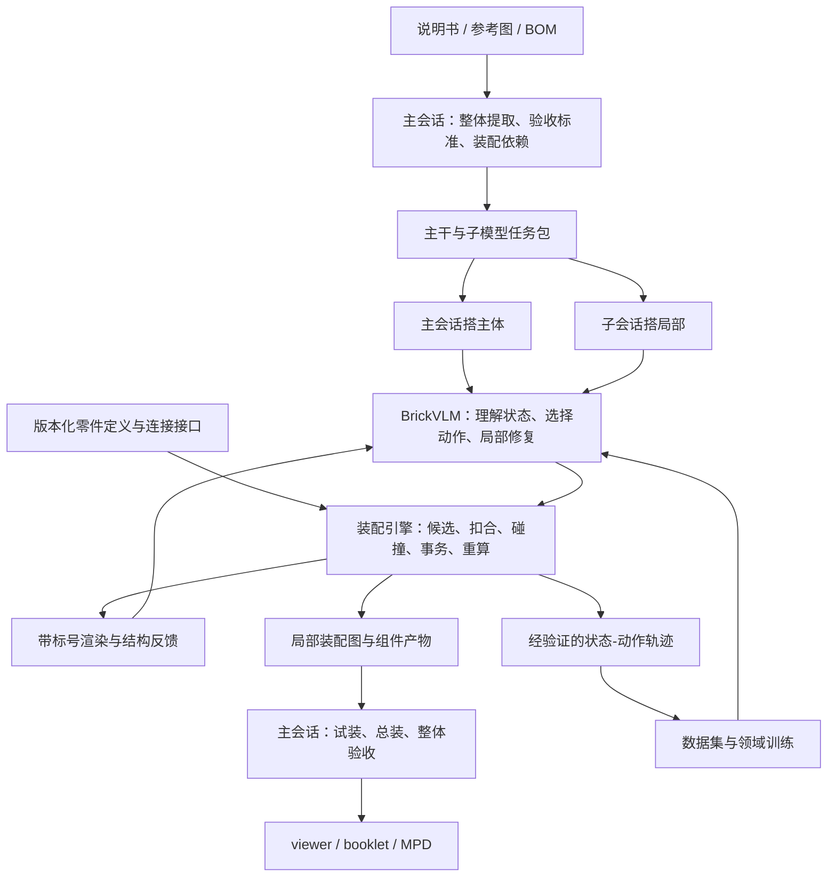

# BrickKit PRD v2：零件素材与装配存储、BrickVLM 专用小模型、主从协同搭建

版本：2.0.0  
日期：2026-10-26  
工作目录：`D:\Project\brickkit`  
文档状态：实施规格；文中的目标值不是已取得的结果。  
执行对象 A：ZCode 中的 DeepSeek v4.1Flash。  
执行对象 B：Antigravity 中的 Gemini 3.8Flash。  
上述 Harness 与模型名称沿用用户指定名称，不代表本文已验证其产品可用性或比较过其能力。

配套任务书：[A：存储与装配引擎](./HANDOFF-A-ZCode.md)、[B：说明书理解与 BrickVLM](./HANDOFF-B-Antigravity.md)。

## 0. 执行摘要

本项目要建立一套可复用的乐高数字搭建系统：将说明书或模型参考图中的结构转为可计算的零件装配关系，由主会话规划、子会话分工搭建，再由主会话总装，最终生成可交互的单文件网页、拼装图纸和 LDraw 文件。

本轮有三个并列的核心交付目标：

1. **优化零件素材与模型装配的存储机制。** 使几何、连接接口、碰撞定义、零件实例、子组件和装配步骤分别具有清晰的权威来源；世界坐标可以重算，组件可以复用。
2. **设计、训练并验证专用小模型 BrickVLM。** 只针对说明书理解、模型结构理解、装配动作选择及局部修复进行领域优化，交付实际权重、推理入口和留出评测。
3. **落地主会话与子会话的四步搭建流程。** 主会话整体提取与设定验收 → 全部零件归总和子模型拆分 → 主体与局部并行搭建 → 主会话将子模型安装到主体。

统一架构原则：**主会话负责全局决策，BrickVLM 负责局部理解与装配决策，装配引擎负责精确计算与约束执行，零件库为三者提供同一套接口定义。**

小模型是正式交付目标。只有训练脚本、数据集或奖励函数，不能宣称已完成专用小模型。

## 1. 问题、目标用户与成功条件

### 1.1 要解决的实际问题

| 问题 | 实际代价 | 本轮响应 |
|---|---|---|
| 零件几何、碰撞体和连接语义不一致 | 看起来可用的素材无法正确拼插，错误被误认为模型理解失败 | 版本化零件定义，分离三种表示，增加真实配对用例 |
| 模型只保存最终坐标 | 修改主体后需要批量手动修位置，无法可靠回放与生成标签 | 局部装配关系为权威，世界坐标作为编译产物 |
| 子组件缺少稳定接口 | 各自完成后无法挂上主体，或总装方向与尺寸不一致 | 分包时定义挂点、局部坐标系和空间约束，搭建中试装 |
| 按页码切任务 | 跨页组件被拆散，重复组件和零新增件总装步骤丢失 | 先提取步骤与依赖，再按装配独立性拆分 |
| 通用模型反复猜零件、朝向和挂点 | 成本高、错误难复现，单步成功不代表整书成功 | 小模型学习局部对应与动作选择，引擎执行，保留恢复轨迹 |
| 零件数量齐全但没有真实装好 | 生成散件陈列，BOM 正确却不能交付 | 指定主体可达性、步骤回放和独立视觉验收 |

### 1.2 用户与角色

- 最终用户：提供说明书或实物参考资料，获得可查看、可分解、可依照拼装的数字模型。
- 主会话：统筹输入理解、验收标准、模块边界、主体结构、歧义处理和总装。
- 子会话：按任务契约搭建独立子模型，交付组件及真实状态。
- BrickVLM：可被主、子会话共同调用的领域模型；任务状态按会话隔离，权重可共享。
- 装配引擎：统一接口匹配、候选生成、位姿计算、碰撞与连接校验、回滚、编译和导出。

实施 Harness A/B 与运行时主/子会话是两种不同角色。A/B 本轮共同开发系统；以后运行系统时再产生模型搭建任务。

### 1.3 本轮成功定义

- 新零件库支持按 ID 加载、稳定连接接口、可追溯覆盖修订和按需打包。
- 模型保留局部关系，根节点变化或子组件翻立后可确定性重算；旧查看器仍可读取编译产物。
- 四步流程有可检查的输入、输出、任务包和总装记录，并完成 60239 开发样例。
- BrickVLM 实际完成一次可复现训练，交付权重和留出评测；达到第 12 节质量门槛后才标记可用。
- 完整导出 `.viewer.html`、A4 横版 `.booklet.pdf`、`.mpd`，保留步骤与子组件语义。

## 2. 范围与优先级

### 2.1 本轮必做

| 编号 | 能力 | 优先级 |
|---|---|---|
| ST | 零件定义、资源索引、修订覆盖、统一单位、稳定接口 ID | P0 |
| AS | 关系装配存储、组件实例、24 种正交姿态、重算、编译兼容 | P0 |
| EN | 连接图、碰撞、候选挂装、事务与错误回滚 | P0 |
| WF | 四步流程、任务契约、零件归属、依赖排序、试装与总装 | P0 |
| MV | 说明书区域与步骤理解、带接口标号的多视角反馈 | P0 |
| ML | 小模型任务协议、数据、基线、SFT、推理、留出评测 | P0 |
| EX | 60239 端到端样例和现有输出格式兼容 | P0 |
| RR | 小模型局部修复训练与受限重试 | P1，正式模型验收前完成 |
| RL | 在可靠监督基线上的强化学习实验 | P2，可独立报告，不能替代 P0 |

### 2.2 本轮边界

- 主要开发输入是官方说明书或用户提供的说明书；保留现有照片输入和证据字段。
- 小模型覆盖模型结构与多视角对应理解；仅凭少量成品照片恢复不可见内部结构，不设为本轮完全自动化承诺。
- 新装配主线先覆盖固定连接、常规堆叠、倒装、正交 SNOT、可拆子组件、轮组中已经有可信接口定义的连接。
- 保留现有机关展示能力；新增任意角度机构求解、弹性变形、摩擦与完整承重仿真不属于本轮必做。
- 接口尚不可信的异形件必须返回明确能力缺口，不能把未知当作已验证。
- 不从零预训练视觉语言基础模型。使用可获得的视觉语言基座做领域微调，具体候选和训练方式在资源预检后记录。

## 3. 现有基线与启动要求

### 3.1 2026-10-26 读取快照

以下值来自编写本 PRD 时对当前工作树的读取，执行前必须刷新，不能当作永久事实：

| 项目 | 读取值 |
|---|---|
| 精选目录条数 | 167 |
| 扩充目录条数 | 4,585 |
| 合并目录条数 | 4,605 |
| 60239 模型件数 | 91 |
| 60239 BOM `totalParts` / 明细求和 | 92 / 91，尚需核准来源和统计口径 |
| 60239 plan | 40 条记录；仅 `main`；页码与机位标记为 assumed |
| 当前严格校验 | 7 errors、17 warnings、36 连通块、最大连通块比例 0.307692 |

当前工作树已有大量未提交、未跟踪实现与素材，包括 `builder.js`、装配树、find-mount、plan 与 diff 等能力。**先盘点和复用，禁止按旧 PRD 从头实现，也禁止把“文件存在”当作行为已验收。**

### 3.2 工作区与证据保护

1. A/B 启动时分别记录 Git HEAD、工作树状态、关键源码与目录哈希、运行环境、已有测试结果。
2. 推荐独立工作区，但两边必须基于同一份已记录的工作树快照，包含本任务需要的未提交与未跟踪源码。仅从当前 Git HEAD 新建工作区可能遗漏已有实现。
3. 如果使用共享目录，严格遵守第 13 节文件所有权。共享文件由唯一所有者修改，另一方提交接口请求。
4. 不清理、覆盖或重生成历史 `out/60239`、既有模型和原 PRD 来制造新结果。新证据写入 `out/prd-v2/<run-id>/`。
5. 修订目录通过覆盖层或明确迁移实现；保留原始来源，不直接把自动提取错误覆盖成“官方事实”。
6. 不重置、回退或覆盖另一方及用户的改动。遇到同文件变更先读取并协调。

### 3.3 已发现、必须加入回归的反例

- 把远处散件声明进子组件后，支撑图可能把它当作真实连接，导致严格校验通过。
- 构造 `snap` 循环时，重算可能没有报错，旧坐标仍被接受。
- 以两片上下扣合板的上片为锚点挂到父砖上，候选搜索可能跳过父件碰撞，导致下片穿入父砖。
- plan 可以与模型及 BOM 自洽，但页码与组件划分仍未从说明书获得独立证据。

这些是回归要求，执行者需要重新复现、修复并记录；不得把历史描述直接当作修复证明。

## 4. 总体架构



基础接口使用版本化 JSON；核心几何逻辑保持可单元测试。保留当前 JS/Node/Three.js 工具链；Python 训练与推理模块独立管理环境，不要求为了训练重写现有查看器。

## 5. 零件素材存储：Part Asset v1

### 5.1 四层存储与建议目录

```text
catalog/
  ldraw/                       现有原始素材，保留
  ldraw-full/                  可选完整镜像，保留现有管理方式
  assets-v1/
    index.json                 零件 ID、别名、修订、资源引用与能力索引
    definitions/<part-id>.json 规范化零件定义，按件加载
    overrides/<part-id>.json   经验证的语义/碰撞/接口修订
    profiles/<profile-id>.json 装配支持范围与数值容差
  cache/                       可重建派生缓存，不作权威源
```

目录结构允许在契约冻结时调整一次；调整需同步 A/B 接口文档。不得要求所有执行任务加载全部精细网格。

### 5.2 零件定义的必需字段

| 字段 | 含义与约束 |
|---|---|
| `schemaVersion` | 规范版本，未知主版本拒绝装配执行 |
| `partId` / `revision` | 稳定零件身份与不可混淆的修订 |
| `aliases` | 有来源的等价编号；印刷替代不自动等价 |
| `source` | 原始文件、来源、哈希、许可信息、提取工具版本 |
| `canonicalFrame` | 统一物理单位、轴向和原点定义，以及原始到规范坐标变换 |
| `geometry` | 外观网格/原始资源引用，按需读取 |
| `collision` | 多盒或其他已支持形状、适用范围、验证状态与证据 |
| `connectors` | 稳定接口 ID、类型、局部位姿、匹配规则和可用自由度 |
| `capabilities` | 可渲染、可碰撞检查、可装配、已验证连接类型等独立状态 |
| `provenance` | measured / inferred / assumed 等证据等级与来源 |

几何存在、碰撞可用、接口可用分别判断。不得用一个 `checked: true` 同时代表三者已验证。

### 5.3 单位、方向与精度

- 内部物理空间采用统一 LDU：1 格 = 20 LDU；1 片 = 8 LDU。外部 builder 继续允许使用整数格/片 API。
- 规范空间采用右手系、`+y` 向上；LDraw 原始空间到规范空间使用明确记录的基变换，不能只对某一轴改符号而忽略手性。
- 连接框架的 `+y` 定义为装配轴；在标准公母接口扣合时采用同向轴约定，适配当前接口匹配语义。显示外法线另行表达，不能混作匹配轴。
- 24 个正交方向的编号与矩阵表版本化，固定 `orientationId=0` 为恒等旋转；矩阵应满足正交性且行列式为 +1，不允许镜像矩阵混入旋转。
- 源素材可包含非整数 LDU。保留来源精度；只有引擎计算或来源证据可产生离格坐标，调用方不能用手填小数绕过 snap。
- 容差集中于版本化 profile。建议初始配置记录 `transformEpsLdu=1e-6`、`connectorPositionTolLdu=0.05`、`connectorAngleTolDeg=0.1`；必须用正确/错误配对夹具验证后冻结。对旧代码中的较宽容差需审计，不能直接扩大新容差放行。
- 碰撞容差只处理浮点边界，不得把真实材料厚度吞掉。碰撞体不可信时返回能力不足。

### 5.4 连接器语义

第一版至少区分 `stud`、`antistud`、`bar`、`clip`、已支持的 `pin`、`hole`、`axle`、`rim`、`tyre` 等类型；每种类型使用独立匹配规则。

每个接口包含：

```json
{
  "id": "side_01",
  "type": "stud",
  "frame": { "translationLdu": [0, 0, 0], "orientationId": 0 },
  "mateProfile": "stud-antistud-v1",
  "capacity": 1,
  "verification": { "status": "verified", "evidenceRefs": ["fixture-id"] }
}
```

上述坐标仅示意字段结构，不是任何真实零件的定义。生产 fixture 必须使用对应素材实测值。

- 稳定接口 ID 是权威标识；旧 `stud/receptor` 数字索引通过带版本的映射适配。
- 接口顺序重排不能静默改变 ID 含义；破坏性变化必须提升 revision 并给出迁移结果。
- 一颗件的多个接口可以同时与不同零件连接。额外连接用来验证约束，不强迫定位依赖产生环。
- 占用和兼容性由引擎计算，不能由小模型自行声称某接口空闲。
- 对轮毂/轮胎等接口核对同轴、轴向范围和尺寸兼容；同轴关系本身不足以证明连接。

### 5.5 覆盖、缓存与按需打包

- 原始几何与覆盖定义分离；加载顺序及冲突优先级固定，生效结果包含合并来源。
- 覆盖记录原始 revision、修改字段、原因、验证用例、责任者和时间。
- 模型锁定使用的零件 revision 与内容哈希；训练样本同样锁定。
- 缓存键包含源几何、覆盖、转换器、profile 的哈希；输入变化后缓存自动失效。
- 同一零件形态只加载/编译一次，颜色与实例变换独立复用。
- 单文件 viewer 仅打包本模型依赖的素材闭包，打开后不得依赖远程零件服务。
- 重命名或不带来源的复制不算存储优化。需报告唯一资源数、重复资源数、包体与加载耗时。

### 5.6 目录预检

`catalog-preflight` 输入模型所需 BOM 与用途，输出逐件的渲染、碰撞、接口、配对装配状态及阻塞项。

- 除缺件外，缺少本任务必需的受体、碰撞定义不可信、未验证的关键连接也应阻塞对应任务。
- 输出 `commandOk` 与 `passed`，避免命令正常执行就被当作目录通过。
- 对 60239 的凹形底盘、侧凸点件、轮拱、轮销、轮毂/轮胎和挡风件执行实际配对测试。
- `50745` 等件先核准官方几何与真实接口，再决定碰撞体分解；不得按未经核准的尺寸硬写三盒并宣称修复。

## 6. 装配存储：BrickBuild 0.3 与编译兼容

### 6.1 权威数据模型

采用 `brickbuild` 0.3 作为关系装配源格式；现有 0.2 文件继续可读。建议权威源文件命名为 `<name>.assembly.brick.json`，编译快照为 `<name>.compiled.brick.json`。

0.3 应包含：

| 对象 | 内容 |
|---|---|
| `assetLock` | 零件 revision、资源与 profile 哈希 |
| `definitions` | 主体或可复用子组件的局部零件/子组件实例 |
| `instances` | 根装配中的组件实例与独立配件归属 |
| `placements` | 根基准或接口定位关系，每个可定位节点恰好一种权威定位方式 |
| `constraints` | 额外扣合、刚性/关节关系及验证约束 |
| `steps` | 原始步骤引用、局部步骤、全局执行顺序、动作与总装事件 |
| `evidence` | 说明书/照片观察引用及证据等级 |
| `derived` | 可选缓存及其输入哈希，不能覆盖权威关系 |

定义、实例和关系的正式 JSON Schema 由 A 负责在 C0 冻结；B 以该版本生成标签与消费数据。本文字段语义是约束，最终 Schema 不得遗漏这些语义。

### 6.2 三种图分别存储和计算

1. **组件归属树**：谁包含谁，用于命名空间、复用和分包；禁止递归包含。
2. **定位依赖 DAG**：哪个根基准/接口关系决定哪个节点的位姿；用于重算。每个节点一个定位来源，缺失引用和环必须报错。
3. **物理连接图**：通过连接器计算获得的实际连接，可存在环；用于连通、额外约束与关节检查。元数据分组不能产生连接边。

固定组件内部需形成连通的固定连接图。含活动关节的组件另有明确关节类型，不能因连通就标为单一刚体。

### 6.3 局部组件与实例

- 子模型保留局部坐标及内部关系，可多次实例化；每个实例有独立全局路径和 BOM 份额。
- 全局引用使用稳定实例路径，例如 `car/front_bumper/lamp_left`；不要依赖数组位置。
- 不在权威源中重复平铺相同组件的所有几何与世界零件。平铺结果仅用于兼容编译和渲染。
- 修改组件模板影响其全部实例；修改单一实例使用显式 instance override，不能污染模板。
- 轮组重复次数、左右镜像件身份、颜色与方向分别记录。旋转不能代替真实左右异形件的身份。
- 局部搭建坐标、施工暂存位置与最终世界位置分开表达。正在桌面搭建的独立子组件可以是合法中间状态，但未完成挂装的车身组件不能进入最终总装通过状态。
- 中间步骤需要临时支撑或翻面施工时，使用明确的施工状态/夹具记录；临时夹具不计入模型 BOM，不得伪造为最终零件连接，也不能用它消除最终悬空错误。

### 6.4 刚体挂装与重算

统一物理空间中的刚体变换：

```text
T_world_child = T_world_parentConnector × T_mate(roll/profile) × inverse(T_local_childConnector)
```

同一刚体内所有零件使用同一个变换；不得分别 snap 后破坏内部距离或旋转关系。

重算必须：

1. 验证资产锁、引用完整性、互斥定位字段和版本；
2. 对定位依赖及嵌套挂装统一拓扑排序，不能依赖“先零件后 mounts 再补一遍”的隐含顺序；
3. 在候选副本中求解全部位姿；
4. 验证额外连接、接口占用、碰撞、主体可达性和步骤约束；
5. 全部成功后原子提交；失败返回结构化错误，输入状态保持不变。

连续重算不得漂移，保存/读取/编译后应等价。可复现哈希不包含生成时间等易变元数据。

### 6.5 对现有项目的适配

- 保留 `createBuilder` 的常用调用，并提供生成关系源的路径。已有 `on/stud/receptor/under` 转为稳定接口关系。
- 旧纯坐标模型导入时保留原始坐标和来源；可推断的连接需记录证据与歧义。不得凭空补出确定的历史 snap。
- 0.3 编译输出 0.2 兼容快照，包含 `parts.at/rot/up/snot` 及现有 `modules/steps/attach/mechanisms` 等必要字段。
- `snot` 输出遵守仓库规范：直接侧装第一层为 0，叠在其上的第二层为 1，后续依次增加。合法位姿的编码不能靠全部清零或随意小数逃避规范。
- 既有 viewer/booklet/MPD 能力逐项回归；0.3 源关系的成功保存不能代替导出验收。
- 原始文件与历史输出不原地批量迁移；先输出新版本并提供差异报告。

## 7. 装配动作与引擎公共契约 C1

### 7.1 模型提出离散动作，引擎计算位姿

动作最少包含 `place_root`、`attach_part`、`attach_assembly`、`inspect`、`abstain`；修复模式增加受限的 `undo`、`detach`、`replace`。第一版不允许模型直接执行任意代码、覆盖全图或手填世界小数坐标。

```json
{
  "protocolVersion": "1.0",
  "taskId": "front-bumper",
  "stateHash": "sha256-of-authoritative-state",
  "actions": [
    {
      "id": "act-003",
      "op": "attach_part",
      "candidateId": "candidate-017",
      "partInstanceId": "pending-03"
    }
  ]
}
```

- candidateId 对应引擎生成的完整接口对、父子身份、姿态、库存项与候选哈希。
- stateHash 不匹配返回 stale-state，不尝试在新状态上执行旧动作。
- 多动作按顺序执行；后续引用通过预声明实例 ID 或明确的前序动作输出，禁止猜测自动编号。
- 根件放置使用任务指定的合法基准；翻面与倒装由接口关系和方向决定。
- `abstain` 给出原因及所需最小补充信息，不能被记为该步完成。

### 7.2 A 向 B 提供的最小 API

| API | 责任与结果 |
|---|---|
| `resolvePart(partId, revision)` | 规范化定义与可用能力 |
| `inspectState(model)` | 实例、真实连接、占用、库存、主体可达性与 stateHash |
| `enumerateCandidates(state, request)` | 合法候选、排序前特征、完整性/截断标识、无解原因 |
| `applyActions(state, request)` | 事务执行、结果状态与逐动作诊断 |
| `recompute(source)` | 原子重算，明确循环/引用/约束失败 |
| `compileLegacy(source)` | 0.2 兼容快照与可追溯实例映射 |
| `renderState(request)` | 图像、相机、实例映射、接口标号/深度信息引用 |
| `validateAssembly(source, task)` | 结构与计划约束的独立检查结果 |

API 可以由 JS 模块与 CLI 双入口提供。B 的 Python 模块通过版本化 JSON 调用适配层，不直接复制核心几何算法。

### 7.3 候选搜索

- 使用连接类型、任务指定部位、接口朝向和占用过滤；支持显式父件/区域/接口限制。
- 每个候选检查与全部相关零件的碰撞，**包括父件**。接触合法性由碰撞体与接口规则表达，不能整件豁免。
- 区分“几何合法候选”和“符合说明书意图的选择”。视觉/任务排序由 B 或主会话完成。
- 输出 `enumerationComplete`、`truncated`、候选数量和限制条件。达到 maxResults 时不能声称无其他候选。
- 无解需区分 missing-asset、unsupported-connector、occupied、collision、out-of-envelope 和 ambiguity；不得自动把零件摆在地面。
- 对称或多挂点等价动作保留等价组，训练评测接受同一正确结果。

### 7.4 结构检查与错误协议

校验结果至少区分：`commandOk`、`passed`、`errors`、`warnings`、`notices`、`unmeasured`、`stats`。

- 结构错误、未核实关键接口、碰撞、未完成步骤不能转成 notice 来消除告警。
- 独立配件名单由冻结的任务计划指定，包含精确实例集合；执行者临时添加 accessory 标志不改变验收归属。
- 总装要求全部车身零件与指定主体根节点通过真实连接可达，未装车身零件数为 0。最大连通分量比例仅作诊断。
- 轮组、独立配件、机构分别按其计划约束验收；浮空视觉位置不代表物理连接。
- `passed=true` 要求本次范围全部硬门禁通过；命令退出码建议 0=通过、1=有效请求但未通过、2=输入/环境/执行错误，并同时保留 JSON 状态。
- 必须有 empty-action、fake-group、循环依赖、父件穿模、旧 stateHash、非法引用及库存重复消费等负例。

## 8. 四步主从搭建工作流

### 8.1 第一步：主会话整体提取说明书并设定验收

输入：说明书原文件、参考图、可获得的 BOM 与版本来源。

输出：`manual.observations.json`、`acceptance.json`、初版步骤/依赖图。

观察记录至少包含：

- 原文件哈希、页码、区域坐标和裁剪资源哈希；
- 原始步骤编号、局部子步骤、是否翻面/重复/总装/无新增件；
- 本步新增零件候选、颜色、数量和证据等级；
- 当前展示组件、观察姿态、安装前/后/爆炸状态；
- 子组件开始、持续和挂装事件，以及不确定项。

观察必须来自原始资料。不得由尚待验收的模型反推全部观察，再以两者一致作为正确证明。

验收标准在搭建前冻结：BOM 口径、车身与配件归属、必测接口、步骤区域、视觉阈值、重试预算及人工介入记录方式。新发现可以修订，但必须生成新 revision 并说明原因，不能为已失败结果追改标准。

### 8.2 第二步：全部零件归总并拆成主体与子模型

输出 `build.plan.json` 与 N 份 task package。

- 按原始设计 ID、颜色、数量守恒核对总 BOM、逐步新增件及子模型份额。
- 区分盒内件数、说明书使用件、备件、贴纸、印刷设计和别名；60239 的 92/91 在这里核准。
- 每颗实际使用件分配唯一 inventory token；重复组件模板实例化时分别占用库存。
- 依据装配依赖和少量对外接口划分任务，不按页码或平均件数硬切。
- 主体负责全局基准、主要尺寸、关键转接结构与挂点，不要求它一定件数最多。
- 子组件应能局部独立搭建；多个无连接部分不能为方便分包强称一个固定刚体。
- 重复轮组可以共用模板；翼子板是否归主体取决于真实装配关系。
- 子组件之间存在依赖时，用 DAG 表达；不以并行数量为目标强行拆分。
- 每个任务启动前对所需零件和配对连接完成 catalog preflight。

### 8.3 子模型任务包契约 C2

| 字段 | 必需内容 |
|---|---|
| 身份 | taskId、revision、依赖任务、全局计划哈希 |
| 素材 | assetLock 与支持 profile |
| 来源 | 相关说明书区域、前后文、局部步骤与置信度 |
| 库存 | 完整 Sub-BOM、inventory token、重复次数 |
| 局部空间 | 原点、朝向、允许的基准与根件 |
| 对外接口 | 子组件锚点/接口 ID、主体目标接口或受约束候选区域 |
| 空间契约 | 主体/组件接口框架、允许包络、keep-out 区域、必须保留的外露接口 |
| 执行预算 | 单步候选重试、局部恢复次数、超时、升级原因 |
| 验收 | 内部连接、BOM、步骤、视觉样本与预期产物 |

任务包中尚不能确定的接口必须标为 pending，先允许不依赖它的局部工作；挂装与最终完成状态等待接口冻结。不能把 pending 当作默认零号接口。

### 8.4 第三步：主会话推进主体，子会话搭局部

- 主会话搭建决定接口的骨架，并发布接口框架及可用空间；子会话在局部坐标系工作。
- 同一 BrickVLM 服务可以供多个会话调用；任务状态、候选列表、库存与回滚记录隔离。
- 每步遵循：理解目标 → 获取候选 → 选择动作 → 引擎执行 → 验证 → 渲染反馈 → 继续或局部恢复。
- 子会话不得改写总 BOM、主体全局基准或自己的库存份额；需要变更时返回结构化接口/计划请求。
- 主体挂点和组件骨架一旦可用，就执行一次临时试装；试装是非破坏性事务，不必等待所有组件完成。
- 试装失败返回具体接口、朝向、空间或碰撞诊断，由相应任务局部返工。
- 子组件交付包括：局部装配源、资产锁、BOM 消耗、接口表、步骤轨迹、内部验证、试装结果和剩余疑点。
- 任务状态使用 `planned/running/needs-interface/needs-repair/ready-for-review/verified/assembled/failed`。只有有证据的任务才能晋级。

### 8.5 第四步：主会话总装与完整交付

1. 按依赖顺序装入已经验证的子组件，核对 task/asset/interface revision。
2. 使用刚体挂装，检查全部相关碰撞、额外扣合、接口占用和主体可达性。
3. 检查总 BOM 守恒、所有 inventory token 恰好消费一次、未装车身件为 0。
4. 回放全书全部步骤，包含零新增件总装步、局部子组件步和翻面；不能只渲染最终状态。
5. 渲染四向正交图并做可获得角度的独立视觉对账；没有对应来源的角度记录未测，不冒充对照通过。
6. 导出 viewer、A4 横版 booklet 和 MPD；人工浏览关键页及组件挂装效果。
7. 产出最终报告，分别陈述结构、视觉、步骤、模型效果与交付物状态。

### 8.6 会话执行适配与收据

- 工作流模块提供 `submitTask/getTaskStatus/fetchReceipt/cancelTask` 的版本化 ExecutorAdapter；不把某个 Harness 的未验证私有接口写死进核心。
- 本轮至少支持文件交接适配器：输出任务包，由真实子会话读取并写回收据，主会话再核对和总装。命令行适配器可在已可用、已授权的接口上追加。
- 每份收据记录 taskId/revision、输入哈希、产物哈希、执行会话 ID、Harness/模型身份、状态、错误、开始/结束时间和校验引用。不能凭智能体自述生成“独立会话已执行”的证明。
- WF-04 需要至少两个真实子会话的任务与收据；同一会话串行生成多个文件只能算流程模拟，不算主从并行验收。
- 会话暂不可自动调度时，文件交接可以完成真实协作；分别报告人工派发和自动派发能力，不能将前者宣称为后者。
- 默认避免在同一 GPU 上同时启动训练与高显存推理；资源调度由已记录的 profile 决定，不以并发数量代替有效吞吐。

## 9. 说明书理解与视觉反馈

### 9.1 页面到状态的分层表达

```text
文档 → 页面 → 区域 → 步骤/局部步骤 → 展示组件 → 装配前/后/爆炸状态 → 目标动作
```

- 分开记录观察与推断；页码、区域和机位不得因填了值就自动升级为 measured。
- 识别同页多步、零件框、箭头、局部放大、重复次数、翻面与总装。
- 每个装配观察关联原始页面区域，不能仅凭总 BOM 分配步骤零件。
- 机位不确定时可标定，但评测机位在测试前冻结；禁止每次改模型后无限择优调整机位。
- 成品封面包含街景等背景时使用独立对象区域/分割方案，不套用浅色说明书背景假设。

### 9.2 接口视觉标号

- 渲染支持实例 ID、稳定接口 ID、类型、装配轴、空闲/占用状态和选中候选。
- 标号使用深度或遮挡判定，只标可见接口；必要时输出底视、背视、剖视或局部放大。
- 控制标签数量，优先当前任务区域。不可读的满屏标号不算完成。
- 同时生成带标号图供理解、无标号图供视觉评分；标签不能混进 diff。
- 输出 2D 标签到 3D 接口的映射 JSON，模型选标号后由程序解析。
- 接口列表与图像绑定 stateHash；旧图像不能用于新状态的接口执行。

### 9.3 掩膜与差异度量

- 自适应浅色背景只是基础能力；主图、零件框、箭头和两栏区域需要语义区分。
- 对爆炸状态分别对齐已有结构、新增件和装配关系，或渲染对应爆炸状态。
- 掩膜准确率用独立标注样本评价，不能用同一算法输出自测真值。
- 保留现有照片 joint 指标与 0.6 门槛；说明书步骤必须按冻结区域与状态独立评分。
- 60239 开发验收采用成品 score ≥0.6、冻结的关键步骤 score ≥0.7，同时要求人工检查关键方向、颜色、组件位置和连接；这些分数不能覆盖结构错误。
- 新版掩膜/指标建立新 report version，与旧分数并列报告，不直接宣称新分数上涨等于还原改善。

## 10. BrickVLM 产品与训练设计

### 10.1 产品形态

一个领域视觉语言模型，支持多任务提示与结构化响应。优先参数高效微调，达到质量要求后再比较其他训练方式。模型家族与规模不按 Harness 名称绑定。

Qwen2.5-VL 3B/7B 可作为原 PRD 延续的初始候选；也允许选择可获得的同级视觉语言基座，但需记录版本、许可、显存、训练支持及基线。本文不宣称某个基座在本项目上最优。

主会话继续承担整书规划；BrickVLM 的第一版重点是局部步骤与组件。全书证据保存在外部状态中，不要求小模型一次记住全书。

### 10.2 四类必训任务

| 任务 | 输入 | 目标输出 |
|---|---|---|
| `understand_step` | 说明书区域、必要前后文、候选件与当前组件 | 新增件、数量、组件归属、方向、重复/翻面/总装事件与疑点 |
| `understand_structure` | 多视角图、实例候选、局部装配图 | 零件对应、连接关系、缺件/错位/朝向差异及证据 |
| `select_action` | 目标步骤、当前状态图、待装件图、合法候选与特征 | 动作/候选排序、关联实例及必要的 abstain |
| `repair_local` | 失败诊断、目标与当前状态、受限修复候选 | 定位错误、最小修复或请求补充视角 |

所有任务统一协议版本。禁止理解模块与搭建模块分别使用互不兼容的接口编号或零件身份。

### 10.3 输入组织

- 目标图与当前图分别输入；必要时增加零件底视或候选挂装小图。
- 文本提供当前 Sub-BOM、相关资产定义、可见接口、候选集合、当前步骤和 stateHash。
- 小模型按任务检索局部零件信息；不把整个素材库塞进上下文或要求记忆全部件号。
- 训练随机化视觉标签与无语义实例 ID，避免只记住 `p019#10` 等偶然编号。
- 不可见接口可由结构上下文和辅助视角支持，但不能伪装成图中可见。

### 10.4 数据样本契约 C3

每条样本至少包含：

```text
sampleId / protocolVersion / taskType
sourceFamilyId / sourceModelId / sourceRevision / split
assetLock / engineRevision / renderRevision
images[]：资源哈希、视角、区域、是否标号
stateRef / stateHash / taskPackageRef
inventory / candidates / candidateEnumerationComplete
target：结构化标签、等价正确动作组、证据引用
verification：几何验证、目标一致性验证、审核来源
```

引擎证明物理合法，不能单独证明符合说明书。真实说明书动作标签必须由参考装配、原图核查或独立复核提供目标一致性证据。

### 10.5 数据来源与课程

1. **基础课程**：常规堆叠、倒装、根件、旋转和接口识别。
2. **复杂接口课程**：SNOT、支架、凹槽、多高度接口和已经验证的轮组。
3. **组件课程**：局部装配、重复实例、刚体翻立与主体挂装。
4. **真实说明书课程**：区域解析、同页多步、重复、翻面、爆炸与零新增件总装。
5. **结构理解课程**：跨视角对应、缺件、错位、错误连接和左右异形件。
6. **恢复课程**：合法但语义错误、接口占用、候选缺失、回退和最小修复。

合成数据由已验证装配图和引擎生成；随机序列必须满足相应课程规则，不能将未验证生成物直接当真值。真实数据保留来源与使用条件，来源不明的数据不进入正式训练集。

### 10.6 数据划分与泄漏控制

- 按模型族和来源划分 train/validation/test；同模型的不同视角、局部组件、改色、编号重排和近重复结构必须同 split。
- 60239 固定为开发/调试样例，不能同时作为泛化测试。
- 进行结构去重，保存 split manifest 与哈希。教师蒸馏不得使用冻结测试答案或测试标注。
- 测试集在选模型、调阈值之前冻结；看过的测试转开发集时必须补建新的留出测试。
- 报告合成、真实说明书、结构理解和恢复子集结果，不能用大量简单堆叠均值掩盖复杂任务。

### 10.7 分阶段训练交付

| 阶段 | 必须产物 | 完成含义 |
|---|---|---|
| R0 资源预检 | GPU/显存/运行时、模型版本、估算磁盘与训练预算、实际可用资源 | 已确定可运行方案，尚未训练 |
| R1 零样本基线 | 同协议提示、固定数据、未微调基座结果、候选覆盖率 | 已建立比较基准 |
| R2 数据与 smoke | 数据审核报告、至少 128 条训练 smoke 样本与独立检查样本、损失/标签检查 | 训练流程跑通，不代表模型可用 |
| R3 领域 SFT pilot | 实际权重/adapter、训练配置、日志、validation 曲线、数据哈希 | 已训练，质量待独立评价 |
| R4 修复与集成 | 恢复样本、受限重试、实际推理服务、会话接入 | 已集成，完整流程待验收 |
| R5 留出验收 | 冻结模型、独立测试报告、完整模型运行与成本报告 | 达到第 12 节后可标记 verified |

建议 pilot 从至少 5,000 个去重的合法/修复状态与不少于 200 个经核查的真实说明书训练步骤启动，依据学习曲线调整。这是数据建设目标，不是“达到数量必然训练成功”的承诺；不足时如实标明阶段。

资源不足时继续完成协议、数据、基线和可复现训练入口，明确资源缺口；实际训练与模型验收保持未完成。不得上传伪权重、以 teacher API 代理冒充本地小模型，或把 CPU 上不可行的长训练无限挂起。

### 10.8 推理与回退

- 提供批量评测和单任务推理入口；输出基座、adapter revision、协议与 stateHash。
- 固定测试中的温度、seed、候选数量、图像尺寸与重试预算；并发吞吐单独测量。
- 单步默认最多 3 次候选执行，局部修复默认最多 2 轮；均可由冻结任务包显式覆盖并计入报告。
- 无解、截断候选和低置信歧义分别处理；强模型/主会话介入要计数，不能记成小模型独立成功。
- 不采用只返回置信度就自动通过的设计；记录准确率与覆盖率，防止全 abstain 获得虚假安全分。

### 10.9 强化学习为后续增强

只有监督基线、奖励负例和独立测试稳定后才开展 RL。

- 协议、库存、真实连接、碰撞、范围和本步新增件完整性构成硬门禁。
- 非法动作不给视觉奖励；空动作不能获得“本步完成”奖励。
- 合法动作再评价新增结构的目标一致性、局部视觉改善和修复成本；不只使用整图 IoU。
- 对物理合法但装错部位、错误颜色、对称误判、相机刷分和重复消费建立奖励攻击测试。
- 奖励评估是可调用的程序，训练中不必每次启动全量浏览器；可缓存固定目标与渲染资源，但不能使用过期 stateHash。
- RL 结果与 SFT 基线分别报告，不以能输出奖励分代表训练有效。

## 11. 数据、隐含不确定性与可复现性

- 原始件号、颜色、元素号、印刷号和几何代理分别存储。确属同一设计的别名可映射；印刷替代必须保留原身份与外观缺失状态。
- 每条来源记录文件哈希和区域；隐藏结构推断标记 inferred，不允许自动 confirmed。
- 所有训练/推理/评测产物包含配置、seed、源代码 revision 或源码哈希、资产锁、模型版本和环境。
- 报告原始 numerator/denominator、样本数、失败数、跳过数和原因。空集合、缺图、无法构建一律不能算通过。
- 本轮不改写原有 AGENTS.md 的几何与验收红线。新交付结构校验必须零 errors、零 warnings；合法身份别名等说明可单列 notices，但不能把尚未解决的问题改名消除。
- 印刷/贴图缺失影响外观还原时，相关视觉范围标记 partial；不能宣称完整复现。
- 保留原始报告，新增报告写新 run；同名输出必须先检查，避免覆盖历史证据。

## 12. 验收矩阵

以下是本 PRD 的拟定工程门槛，尚未测得。确需修改时先记录新版本及理由，再运行新一轮测试；不得在失败后只改门槛并沿用旧通过结论。

### 12.1 存储与引擎

| ID | 验收项 | 通过标准 |
|---|---|---|
| ST-01 | 资产修订与重现 | 同一 lock 解析相同定义；输入变动使缓存失效；未知/缺失 revision 明确失败 |
| ST-02 | 几何/碰撞/接口分离 | 三项能力独立报告；未验证接口不能执行关键连接 |
| ST-03 | 稳定接口 | 重排索引不改变 ID；旧索引通过固定映射得到原接口 |
| ST-04 | 按需与复用 | 相同 part revision 不重复编译几何；viewer 只包含依赖闭包且离线可开 |
| ST-05 | 数值与基变换 | 统一单位测试通过，原始/规范往返与方向一致，无镜像误用 |
| AS-01 | 根节点迁移 | 子件、挂装组件及后续挂接全部跟随，内部距离保持 |
| AS-02 | 正交挂装 | 全部 24 姿态、正反侧装及不同锚点夹具通过；保持手性与接口一致 |
| AS-03 | 嵌套与次序 | 嵌套组件、依赖于组件内部件的后续件统一排序，无迭代补丁次序依赖 |
| AS-04 | 非法图 | 缺失引用、循环、双重定位、递归模板必须报错并原子回滚 |
| AS-05 | 幂等和序列化 | 连续 100 次重算无漂移，保存/读取/编译后位姿在 profile 精度内等价 |
| AS-06 | SNOT 编码 | 直接侧装与叠层满足 0/1/2…规范，渲染、校验、导出一致 |
| EN-01 | 真实连接 | fake-group 反例必须失败；分组声明不改变物理图 |
| EN-02 | 父件碰撞 | 上片锚定、下片穿父砖等反例被候选和执行同时拒绝 |
| EN-03 | 占用/库存 | 占用接口、重复库存、旧 stateHash、重复动作被拒绝，无部分提交 |
| EN-04 | 主体可达 | 全部车身件可达指定主体；任意散落车身件必须失败；配件名单不能临时扩大 |
| EN-05 | 目录配对 | 本开发样例全部必需连接有正例和错位/方向/碰撞负例 |
| CP-01 | 旧模型兼容 | 现有代表模型的编译结果无新增结构问题，步骤/组件/机关语义无回退 |
| CP-02 | 性能可复测 | 固定硬件上报告 100/1,000 件夹具的加载、重算、候选与内存 P50/P95；后续回归对已冻结基线不得无解释恶化超过 20% |

### 12.2 工作流、视觉与交付

| ID | 验收项 | 通过标准 |
|---|---|---|
| WF-01 | 来源独立 | 所有关键步骤与组件边界可回溯原页区域，不能仅由模型反推 |
| WF-02 | 零件守恒 | 总 BOM、逐步增量、任务份额及实际消费逐 ID/颜色一致；备件等另列 |
| WF-03 | 任务契约 | 每个子任务有 C2 全字段、revision 和接口状态，错误版本总装被拒绝 |
| WF-04 | 并行及试装 | 主体与至少两个独立子组件按依赖推进，至少一次早期试装有记录 |
| WF-05 | 步骤完整 | 全部原始步骤有状态与动作映射，包括翻面、重复和零新增件总装 |
| MV-01 | 标号 | 可见接口可读、无遮挡误标，2D/3D 映射与 stateHash 一致 |
| MV-02 | 掩膜 | 不少于 30 个独立标注区域，覆盖多栏/箭头/透明/白件/爆炸/封面；主图掩膜 IoU 均值 ≥0.90，并列出最差样本，不能仅看均值 |
| MV-03 | 指标有效性 | 漏件、左右互换、保险杠反向、错误位置等负例可被相应结构/视觉检查发现 |
| EX-01 | 60239 总装 | 经核准的应装件全部归位，未装车身件 0，严格结构校验 0 errors/0 warnings |
| EX-02 | 60239 视觉 | 成品 ≥0.6，冻结关键步骤各 ≥0.7；关键方向、颜色、接口人工检查通过 |
| EX-03 | 输出 | 单文件 viewer 离线打开、逐步播放、组件爆炸与机关回归；PDF A4 横版无裁切/漏步；MPD 结构与位姿正确 |

说明书本身无法提供四向参考时，仍需四向渲染检查；缺少来源的角度单列未测，不将其自动加入“全部对账通过”。

### 12.3 小模型与实际效果

模型独立留出集至少包含 300 个步骤/结构/恢复案例、3 个未用于训练和调参的模型族，其中不少于 100 个真实说明书步骤。数据不够时可以做 pilot，但不能通过 R5。

| ID | 指标 | 通过标准 |
|---|---|---|
| ML-01 | 数据无泄漏 | 模型族级 split、结构去重、哈希与审核记录完整 |
| ML-02 | 正确候选覆盖 | 在声明支持的留出装配任务中 ≥99%；截断与无解单列 |
| ML-03 | 实际权重 | 可加载的 checkpoint/adapter、精确基座与配置、训练日志、独立推理结果齐全 |
| ML-04 | 动作语义正确 | 支持范围内、允许等价动作的 Top-1 ≥90%、Top-3 ≥97%；按真实/合成/SNOT/组件分别报告 |
| ML-05 | 理解能力 | 新增件清单精确匹配率 ≥90%；结构错误检测 F1 ≥0.85；恢复成功率 ≥80%，同时报告错误触发率 |
| ML-06 | 领域优化收益 | 同基座同协议下，动作正确率提升 ≥5 个百分点或错误率降低 ≥20%；若走效率目标，正确率 ≥90% 且较比较基线下降不超过 2 个百分点，完成同一任务的实测成本至少下降 30% |
| ML-07 | 完整流程 | 3 个留出模型逐个记录整书/组件任务完成情况、重试和介入；在固定预算内至少 2 个零人工装配修正完成，且完整成功数不低于比较基线 |
| ML-08 | 诚实状态 | 强模型介入、abstain、失败、未测均单列；不能用引擎拦住非法动作的比例冒充模型正确率 |

ML-07 的“完成”要求对应模型的结构与视觉验收通过。未完成模型不得作为成功成品交付。此门槛用于领域小模型首版；任何“可独立可靠完成所有模型”的更强声明需要额外证据。

ML-06 的比较基线在 R1 冻结：至少包含同一视觉语言基座的未微调版本；若主张替代当前强模型，再增加该强模型基线。质量收益和效率收益分别陈述，不换比较对象刷提升。

统一计分口径：

- 支持范围和测试子集在运行前冻结。unsupported 与超范围样本仍报告覆盖率，不能试完后移走失败样本。
- 候选覆盖率分母为冻结范围内全部有参考动作的装配案例；搜索截断导致漏解按未覆盖计。
- Top-1/Top-3 按参考状态与等价动作组判定；正确候选缺失、abstain、解析失败和预算内未完成均计错误，不只在模型答题成功的子集上算。
- 新增件清单用件号、颜色、数量的整步精确匹配；结构错误 F1 同时报告总体与按错误类型的宏平均，以宏平均为门槛；修复率分母为预先标记可修复的全部案例。
- 成本按同一硬件/计费口径下每个成功完整任务统计，计入候选生成、渲染、失败重试、恢复和强模型调用；没有可比成本数据时不能通过效率收益轨。

## 13. 双 Harness 分工与协作规则

### 13.1 职责分配

**A：ZCode / DeepSeek v4.1Flash——存储、装配引擎与最终代码集成。**

- 负责 ST/AS/EN/CP 主线，公共 JSON/API 契约、兼容编译与根 CLI 集成。
- 提供真实可用的候选、动作、渲染与校验 API，维护版本与 mock 对照夹具。
- B 就绪后集成其入口、依赖与说明书/模型推理调用，推进系统端到端联调。
- 独立复核 B 的数据划分、训练证据和留出评测可复现性。

**B：Antigravity / Gemini 3.8Flash——说明书理解、任务分包、视觉反馈与 BrickVLM。**

- 负责 WF/MV/ML 主线，观察/任务包、真实说明书标注、数据与训练推理模块。
- 使用 A 的契约开发，可先用 mock；mock 结果不能进入正式行为验收。
- 负责 60239 的来源观察、计划与新流程构建任务，使用引擎完成模型产物；向 A 提交实际集成问题。
- 独立复核 A 的真实连接、重算、父件碰撞、组件挂装和兼容输出。

该分配依据工作边界，未包含对两个模型能力强弱的假定。

### 13.2 默认文件所有权

| 唯一所有者 | 默认写入范围 |
|---|---|
| A | `src/core/core.js`、`src/core/builder.js`、`src/core/assets-v1/`、`src/core/assembly-v1/`、`src/core/actions-v1/`、`src/ldraw/`、`catalog/` 的候选覆盖与新索引 |
| A | `cli/brickkit.mjs`、根 `package.json/package-lock.json`、`build.mjs`、兼容所需的既有 viewer 入口与几何适配文件 |
| A | 零件/装配/动作 Schema，ST/AS/EN/CP 测试，`docs/prd-v2/implementation-A/` |
| B | `src/manual-v2/`、`src/brickvlm/`、`src/viewer/stud-overlay-v2.js` 等新增独立视觉模块 |
| B | `tools/manual-v2/`、`tools/brickvlm/`、`training/brickvlm/`、独立 Python 环境配置与推理适配 |
| B | 观察/计划/任务包/数据集 Schema，WF/MV/ML 测试，`docs/prd-v2/implementation-B/` |
| 双方各自 | `out/prd-v2/<run-id>/A/` 或 `/B/`，禁止相互覆盖 |
| A 集成 | `README.md`、`docs/数据格式.md`、公共说明、B 模块导入/CLI 注册片段和最终候选发布包 |

原有 `src/core/diff.js` 默认由 B 修订视觉算法，但 A 只能通过约定导出调用，不能并行编辑同文件。B 不直接改 root CLI 或主 viewer 入口，提交可应用的集成片段由 A 合入。

本 PRD 与两份任务书作为本轮输入规格保持只读；实现选择和请求写入各自 implementation 目录。若需要修订规格，形成 change-request，明确影响后再生成新版本，不能一方静默改公共契约。

### 13.3 C0 契约冻结与沟通

1. A 盘点现有接口并提交 C1/资产/装配 Schema 草案与示例。
2. B 提交 C2/C3、观察区域及渲染需求，并对 A 草案给出具体兼容意见。
3. A 集成形成 `contracts-1.0`，双方各自记录已消费的哈希与可运行示例。
4. 未冻结前，双方可完成基线、夹具、资源探测、离线模块及数据观察；正式训练标签等待动作与接口版本稳定。
5. 破坏性变更提升协议版本，附旧样本/模型影响、迁移方法和重跑范围。
6. 通过用户转交交接文件、已有授权的 Harness 通道或共享请求文件协调；文档本身不要求自动向其他聊天发消息。

请求文件使用不同路径：A 写 `implementation-A/requests-to-B/`，B 写 `implementation-B/requests-to-A/`。回复由被请求方写其自己目录的 responses，不共同编辑一张状态表。

### 13.4 独立复核

- 每个里程碑由实现方提供 manifest 和命令，另一方在该候选 revision 上复跑关键正负例。
- 独立复核报告只读被审代码；发现问题先返回，不能边修改边宣称独立通过。
- A 的存储/引擎通过状态需要 B 的复核；B 的模型效果通过状态需要 A 的复核。
- 不能因另一方暂未回复而伪造复核通过；可继续无依赖任务。

## 14. 阶段计划与退出条件

| 阶段 | A 的任务 | B 的任务 | 退出条件 |
|---|---|---|---|
| P0 基线与 C0 | 资产/图/接口现状、负例、Schema 与适配草案 | 页面观察、任务协议、训练资源与数据可用性 | 同一基线记录、contracts-1.0、BOM 口径待办明确 |
| P1 存储与装配基础 | Part Asset v1、关系源、原子重算、24 姿态、真实连接、兼容编译 | 观察/分包实现、标号模块、人工核查开发数据、mock 对接 | ST/AS/EN 关键正负例与双方接口调用通过 |
| P2 四步流程与基线 | 候选/动作/渲染接口性能及集成 | 60239 计划与任务包、现成模型四步流程、BrickVLM R1 | 主体与子组件真实试装、模型基线与候选覆盖报告 |
| P3 数据与实际训练 | 引擎数据生成支持、数据与标签抽查 | R2/R3、实际 SFT 权重、初步验证与结构/修复任务 | 真权重可加载、训练可复现、无数据泄漏 |
| P4 端到端与恢复 | 根 CLI/viewer/booklet/MPD 集成、完整验证 | R4、真实模型调用、局部恢复、60239 完整交付 | EX 全通过；记录模型/主会话各自贡献 |
| P5 独立留出与交付 | B 的权重/评测复核、整体验收汇总 | A 的引擎/兼容复核、R5 留出运行 | 达到全部适用验收项；未达项明确列出 |

训练数据采集从 P0 开始，正式领域训练在动作、资产版本稳定后进行。小模型不应等到所有展示优化结束才开始，也不能在接口尚频繁变化时批量制造过期标签。

不给出没有硬件和数据依据的天数承诺。P0 后提供关键路径与有依据的工时/资源估计，按依赖推进。

## 15. 建议命令与交付接口

以下为目标命令，**当前是否存在由实现方盘点，不能直接当作已有命令执行成功**。可保留现有命令名并添加子命令，但 JSON 协议语义须一致。

文中的 `brickkit` 是 CLI 简写；未安装命令入口时使用 `node cli/brickkit.mjs`，不要求修改系统 PATH。

```text
brickkit assets inspect / preflight / compile
brickkit assembly validate / recompute / compile / inspect
brickkit candidates <state> --task <task-package>
brickkit actions apply <state> --request <actions.json>
brickkit manual extract <pdf> --out-dir <run>
brickkit workflow plan <observations> --bom <bom> --out-dir <run>
brickkit workflow run <plan> --executor <provider-config> --out-dir <run>
brickkit workflow assemble <plan> --receipts <dir> --out-dir <run>
brickkit render <compiled-model> --show-connectors --task <task> ...
brickkit acceptance <plan> --run <run-dir>
```

Python 模型模块提供等价入口：

```text
python -m brickvlm.preflight --config <config>
python -m brickvlm.dataset --config <config>
python -m brickvlm.evaluate --config <baseline-or-checkpoint>
python -m brickvlm.train --config <train-config>
python -m brickvlm.serve --config <inference-config>
```

本机解释器、模块路径与依赖安装位置写入运行说明。Node 工具可通过子进程 JSON 或本机服务调用，协议保持一致；密钥仅用运行时配置引用，不写入训练样本、模型包或报告。

## 16. 交付物与完成报告

### 16.1 A 的交付

- 规范化资产索引、定义、覆盖、profile 与迁移/兼容适配。
- 关系装配源、编译器、重算、候选、动作与严格校验模块。
- 根 CLI 和既有导出集成，ST/AS/EN/CP 测试及独立复核请求。
- 缓存/打包/性能报告、已支持与未支持接口清单。

### 16.2 B 的交付

- 观察、步骤、分包和 C2 任务包实现，接口标号与视觉对账。
- 60239 新流程产物与来源证据，构建/总装/回放记录。
- 训练数据与 split manifest、基线、训练代码、实际 checkpoint/adapter、推理配置。
- 留出评测、恢复与成本报告，以及 WF/MV/ML 测试。

### 16.3 联合交付

```text
out/prd-v2/<run-id>/
  manifest.json
  A/
  B/
  integration/
    source.assembly.brick.json
    compiled.brick.json
    build.plan.json
    task-packages/
    receipts/
    renders/
    model.viewer.html
    model.booklet.pdf
    model.mpd
    acceptance.json
  cross-review/
  final-report.md
```

权重和大数据可放独立受控目录，在 manifest 记录真实绝对/相对路径、哈希、大小、基座依赖及加载命令，不能用不存在的占位路径。

最终报告固定分别回答：

1. 零件素材存储与装配机制哪些已实现、哪些已验证、哪些仍不支持？
2. 四步流程是否实际完成主体、子组件、试装和总装？是否有未装件？
3. BrickVLM 是否实际训练，权重在哪里，训练/测试是否隔离，较基线改善多少？
4. 哪些结果依赖主会话或强模型介入，哪些由小模型独立完成？
5. viewer、PDF、MPD 和全部适用验收项分别是什么状态？

状态使用 `not-started/implemented/unverified/verified/partial/failed/unavailable`，每项附证据。不得用“代码已写”“训练命令已提交”“CLI 退出 0”“文件数量增加”替代实际完成。

## 17. 技术依据与待证假设

以下资料用于设计依据，不能当作本项目已达到效果：

- [LDraw 官方格式规范](https://ldraw.org/article/218.html)：单位、坐标与实例变换的依据。BrickKit 的规范坐标与源坐标仍需显式适配。
- [BrickGPT 原始项目](https://avalovelace1.github.io/BrickGPT/)：下一积木预测结合程序检查与回退的参考；它的文本生成任务不等同于本项目的说明书重建。
- [LEGO Co-builder 原始论文](https://arxiv.org/abs/2507.05515)：需要分别测试零件识别、细粒度结构和装配状态理解，不能仅用识别结果代表搭建能力。
- [Qwen2.5-VL 官方介绍](https://qwenlm.github.io/blog/qwen2.5-vl/)：视觉定位与结构化输出的候选基座能力依据，不构成此项目基座优选证明。
- [Set-of-Mark 原始研究](https://arxiv.org/abs/2310.11441)：视觉标号的设计参考；接口标号在积木细小、遮挡场景中的效果仍须本项目验证。

需要实验证实的关键假设：稳定接口和候选约束能降低小模型动作难度；局部任务与显式状态能提升长流程成功率；合成装配数据结合真实说明书能迁移；主从分包节省的时间大于接口协作成本。各假设以本 PRD 的基线、留出实验和端到端记录验证。
