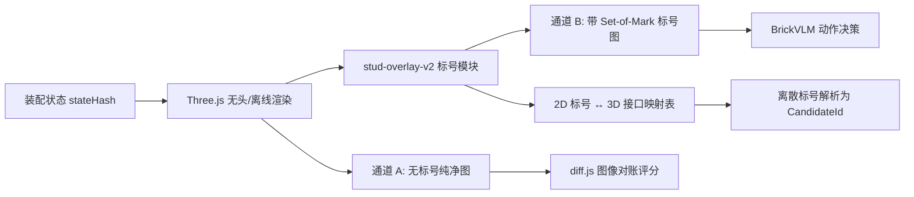

# 视觉反馈与标号渲染需求规格 (Render Requirements)

- **责任者**：Task B (Antigravity)
- **目标组件**：`src/viewer/stud-overlay-v2.js` 与渲染管线
- **适用协议**：PRD Section 9.2 (MV-01) 与 C1 `renderState` 接口

---

## 1. 核心需求概览

在乐高说明书拼装与 BrickVLM 动作决策中，纯文本坐标无法被视觉语言模型直观对应。必须建立**带 2D 接口标号的视觉理解图**与**无标号的纯净评分图**的双通道渲染机制：



---

## 2. 标号与可见性规则 (MV-01)

1. **遮挡剔除 (Occlusion Culling)**：
   - 必须通过光线投射 (Raycasting) 或深度缓冲比较 (Depth Buffer Z-test) 剔除被其他积木遮挡的背面接口。
   - 只有正面法线朝向相机且未被实体包围盒遮挡的接口才能绘制 2D 标号。
2. **空闲与占用判定 (Free vs. Occupied)**：
   - 已被扣合的接口默认不显示，或以半透明虚线标出（防止视觉干扰）。
   - 仅高亮当前待装部位涉及的**可用空闲接口 (Available Connectors)**。
3. **标签密度控制与局部放大**：
   - 当视口内接口密集（如 16×16 底板上有 256 个凸点）时，禁止全局满屏铺设标签。
   - 依据当前任务包的 `taskId` 与待装区域，限制标签数量在 ≤ 32 个关键接口内；必要时自动切入局部特写视角。
4. **稳定 2D 标签格式**：
   - 标签以圆圈内数字或字母呈现（如 `①`, `②`, `③` 或 `A1`, `A2`）。
   - 附带统一的映射文件 `connector-map.json`：
     ```json
     {
       "stateHash": "9f83a...",
       "view": { "azimuth": 315, "elevation": 25 },
       "labels": [
         {
           "tag": "1",
           "2d": [452, 310],
           "partInstanceId": "p012",
           "connectorId": "stud_01",
           "type": "stud",
           "up": "+y"
         }
       ]
     }
     ```
5. **通道分离严格红线**：
   - **绝对禁止**将带圆圈标号的图像送入 `diff.js` 评分！标号图只用于人类交互与多模态模型动作选择，评分必须使用通道 A 的无标号纯净渲染图。
