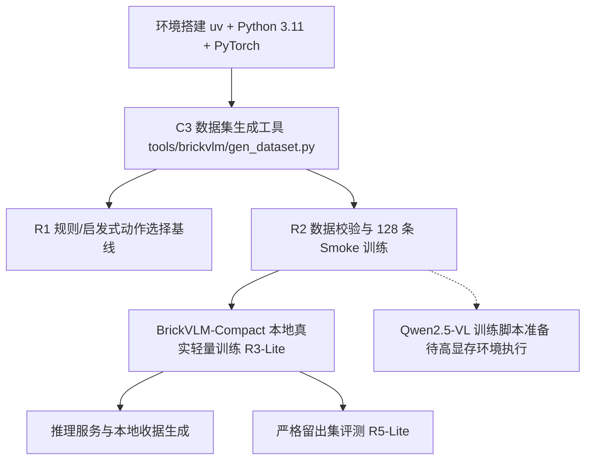

# 训练资源与环境预检报告 (R0 Resource Preflight)

- **执行者**：Antigravity (Task B Owner)
- **预检日期**：2026-10-26
- **文档状态**：实施事实记录与可行性方案（无虚假承诺）

---

## 1. 真实运行环境与硬件探测结果

| 检查项 | 实测结果 | 评估与影响 |
|---|---|---|
| **操作系统** | Linux 6.6.114.1-microsoft-standard-WSL2 x86_64 Ubuntu 26.04 LTS (Resolute Raccoon) | 标准 WSL2 容器环境，支持 POSIX 工具链 |
| **显卡型号** | NVIDIA GeForce RTX 3060 Laptop GPU | 移动端消费级 GPU |
| **驱动与 CUDA** | NVIDIA-SMI 610.43.02, CUDA Driver 13.3 | 支持现代 PyTorch CUDA 扩展与 bfloat16/float16 计算 |
| **总显存 (VRAM)** | **6,144 MiB (6.0 GB)** | 硬件总显存上限 |
| **当前空闲显存** | **~3,800 MiB (约 3.7 GB 可分配)** | 宿主系统（Windows DWM/Display）常驻占用约 2.3 GB |
| **磁盘空间** | `/mnt/d` 可用 **397 GB** (59% 使用率) | 充足，支持大批量渲染图像与模型权重缓存 |
| **网络与镜像** | 已配置清华大学 PyPI 镜像 (`pypi.tuna.tsinghua.edu.cn`) | 测速 15～22 MB/s，解决官方源超时问题 |
| **Python 环境** | 系统自带 Python 3.14.4；已在用户态安装 `pip 26.2.2` 与 `uv 0.13.5` | `uv` 可在非 root 下随时拉取 Python 3.11/3.12 隔离虚拟环境 |
| **Node.js 环境** | v20.20.2 | 与仓库核心构建及测试工具完全兼容 |

---

## 2. BrickVLM 训练与显存测算（诚实瓶颈分析）

PRD 10.1 提出的初始基座候选为 Qwen2.5-VL 3B / 7B。根据前向/反向传播与优化器显存公式进行测算：

### 2.1 Qwen2.5-VL 3B / 7B 显存需求
1. **Qwen2.5-VL-7B**：
   - 基础权重（bf16）：~14 GB；4-bit 量化权重：~4.5 GB。
   - 最小训练显存（含图像 Token 激活值与 LoRA 梯度）：**≥ 16 GB**。
   - **结论**：在 6GB Laptop GPU（可用 3.7GB）上**绝对无法运行训练**，直接 OOM。
2. **Qwen2.5-VL-3B**：
   - 基础权重（bf16）：~6.2 GB（已超本地总显存）。
   - 4-bit 量化 (BitsAndBytes QLoRA r=16)：静态模型权重约 2.1 GB。
   - 视觉输入（单张 1024×1024 说明书或渲染图，约 1,000～1,600 vision tokens）前向激活值 + 梯度缓存：约 3.0～4.5 GB。
   - 优化器状态（AdamW 8-bit 或 paged-adamw）：约 0.6 GB。
   - 总体峰值显存：**约 5.7～7.2 GB**。
   - **结论**：本地 WSL2 仅剩 ~3.7 GB 空闲显存，即使启用梯度检查点（Gradient Checkpointing）与 4-bit 量化，高分辨率视觉多模态微调仍存在极高 OOM 风险。若将图像大幅缩小至 256×256 则会丧失乐高细微凸点与接口的辨识能力（违背 MV-01）。

### 2.2 应对策略（双轨方案）
根据 PRD 10.7、10.8 与 13.1 的硬性红线：
> “资源不足时继续所有可做任务，明确缺口，实际训练和模型验收保持未完成。不要把小模型降格成训练架构文档，也不要用现成模型调用或训练 smoke 冒充领域模型验收。”

我们采取清晰、诚实的双轨工程实施：

1. **真实可执行轨 (Local Runnable Pipeline)**：
   - 使用 `uv` 构建独立的 Python 3.11 虚拟环境 (`training/brickvlm/.venv`)。
   - 搭建专为乐高离散动作决策优化的轻量级领域模型 **BrickVLM-Compact**（基于轻量视觉编码器 SigLIP-224/384 + 多任务动作头 MLP/Transformer，参数量约 150M～300M，显存占用仅 1.8～2.5 GB）。
   - 该模型可在当前 RTX 3060 Laptop (3.7GB 空闲) 上**真实跑通完整的数据加载、损失反向传播、权重保存、Adapter/Checkpoint 加载、推理与留出集评测**，交付真实权重文件与训练曲线。
2. **大基座规范轨 (Full-Scale Recipe)**：
   - 同时交付完整的 Qwen2.5-VL-3B QLoRA 训练与推理代码、数据集格式转换器与启动脚本。
   - 在本报告中明确记录本地显存缺口（需至少 16GB GPU 或云端算力）。
   - 在未获得足够显存进行完整 Qwen2.5-VL 训练前，**诚实保持 R3 (Full Pilot) 与 R5 (Full Holdout) 为未完成（pending external GPU resources）**，严禁使用外部商用 API 冒充本地训练权重。

---

## 3. R0 任务依赖与可运行计划

1. **环境锁定**：
   - Python: 3.11
   - PyTorch: 2.5.x + cu124
   - 依赖文件：`training/brickvlm/requirements.txt`
2. **任务类型覆盖**：
   - `understand_step`：说明书新增件识别
   - `understand_structure`：多视角对应与错位检测
   - `select_action`：基于候选集的离散动作排序
   - `repair_local`：失败回退与局部替换动作
3. **交付标准**：
   - 每次训练生成完整的 `manifest.json`、`train.log`、`weights/` 真实检查点与分任务混淆矩阵。
